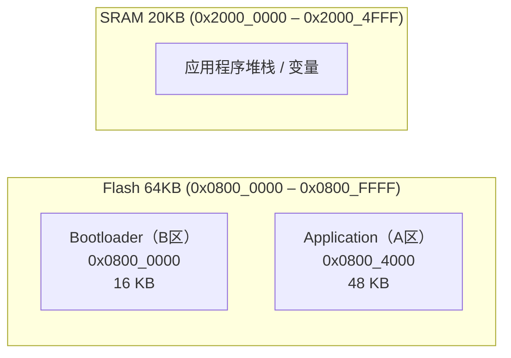
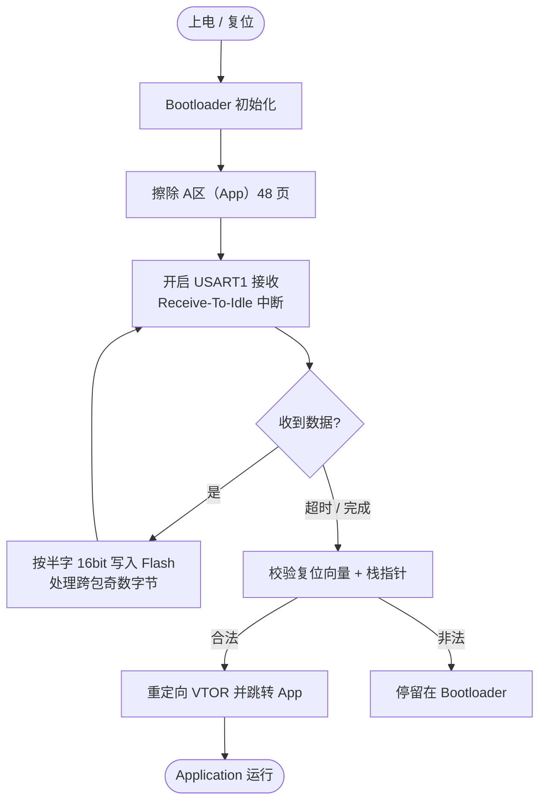

<div align="center">

# STM32 UART Bootloader（串口 IAP 固件升级）


**无需调试器，仅用一根串口线即可给 STM32 烧录 / 升级固件**

</div>

---

## 项目简介

这是一个运行在 **STM32F103C8T6** 上的 **UART 串口 Bootloader（IAP，In-Application Programming）**，
目标是在产品出厂后、或现场维护时，**不拆壳、不接 SWD/JTAG 调试器**，仅靠 USART1 就能把新的应用程序固件写入 Flash 并完成跳转运行。

核心价值：

- **零额外硬件**：复用板载串口（PA9/PA10），不需要专用下载器。
- **适合量产与售后**：产线烧录、远程/现场固件升级（OTA 的"有线版"）都可直接复用。
- **代码量小、可读性强**：核心逻辑集中在 `int_bootloader.c`，适合作为嵌入式底层能力的"能力样本"。

> ⚠️ **项目状态**：当前为 **WIP（开发中）**。基础烧录链路已跑通（已编译出 `.axf` / `.hex`），
> 但上位机协议、回读校验等仍在完善，详见文末 [路线图](#路线图) 与 [已知问题](#已知问题待完善)。

---

## 硬件平台

| 项目 | 说明 |
| --- | --- |
| MCU | STM32F103C8T6（Cortex-M3，72 MHz） |
| 封装 | LQFP48 |
| Flash | 64 KB（0x0800_0000 – 0x0800_FFFF） |
| RAM | 20 KB（0x2000_0000 – 0x2000_4FFF） |
| 串口 | USART1，**115200 / 8 / N / 1** |
| 引脚 | TX = PA9，RX = PA10 |
| 工具链 | STM32CubeMX 生成工程 + Keil MDK-ARM，HAL 库 |

---

## Flash 与内存布局

Bootloader 自身占用 Flash 前 16 KB，应用程序紧接其后，从 `0x0800_4000` 开始。
跳转时通过重定向中断向量表（`SCB->VTOR`）让应用程序接管中断。



| 区域 | 起始地址 | 大小 | 用途 |
| --- | --- | --- | --- |
| B区（Bootloader） | `0x0800_0000` | 16 KB | 引导程序自身 |
| A区（Application） | `0x0800_4000` | 48 KB | 用户应用程序 |
| SRAM | `0x2000_0000` | 20 KB | 运行时内存（栈指针合法性校验区间） |

---

## 工作原理

上电后 MCU 先运行 Bootloader，流程如下：



关键实现要点（对应 `MDK-ARM/interface/int_bootloader.c`）：

1. **中断驱动接收**：使用 `HAL_UARTEx_ReceiveToIdle_IT()`，以"空闲线（Idle Line）"判定一帧数据结束，
   全程中断驱动，主循环不阻塞轮询。
2. **半字写入 Flash**：STM32 Flash 以 16 位（halfword）为最小编程单位，接收缓冲按双字节拼装后调用
   `HAL_FLASH_Program(FLASH_TYPEPROGRAM_HALFWORD, ...)`。
3. **跨包奇数字节拼接**：当某次接收长度为奇数时，会把最后一个字节暂存，与下一组数据的首字节拼成完整的半字，
   保证任意长度固件都能正确落盘（见 `data_remain_flag` / `remain_data` 逻辑）。
4. **跳转前合法性校验**：跳转前检查**复位向量地址**是否落在 A 区范围内、**栈顶指针（MSP）**是否落在 SRAM 范围内，
   避免跳到一个非法/未烧录区域导致死机。
5. **向量表重映射 + 干净跳转**：关闭中断 → `HAL_DeInit()` → 设置主堆栈指针 `__set_MSP()` →
   `SCB->VTOR = A区地址` → 调用应用程序复位向量，完成"无痕迹"交接。

---

## 目录结构

```
uart_bootloader/
├── Core/                     # 应用框架（CubeMX 生成 + 用户代码）
│   ├── Inc/                  # 头文件（main.h / usart.h / gpio.h ...）
│   └── Src/                  # 源文件（main.c / usart.c / gpio.c ...）
├── Drivers/                  # STM32 HAL 库 + CMSIS（CubeMX 引入，遵循其 LICENSE）
├── MDK-ARM/
│   ├── interface/            # ★ Bootloader 核心实现
│   │   ├── int_bootloader.h
│   │   └── int_bootloader.c  # 接收 / 擦写 Flash / 校验 / 跳转
│   └── uart_bootloader/      # Keil 工程与编译输出（*.axf / *.hex / 中间文件）
└── uart_bootloader.ioc       # STM32CubeMX 工程配置
```

> 实际 Flash 烧录逻辑集中在 `MDK-ARM/interface/int_bootloader.c`，
> 入口 `int_bootloader_init()` 在 `main.c` 中调用，跳转 `int_bootloader_jump_to_app()` 在主循环中触发。

---

## 编译与烧录

1. 用 **STM32CubeMX** 打开 `uart_bootloader.ioc` 生成/同步工程（已配置 USART1、HSE 8M→PLL 72M）。
2. 用 **Keil MDK-ARM** 打开 `MDK-ARM/uart_bootloader/` 下的工程，编译得到 `uart_bootloader.hex`。
3. 首次用 ST-Link / DAP-Link 等把 Bootloader 烧录进 `0x0800_0000`（16 KB 内）。
4. 之后即可通过串口发送应用程序固件（起始地址 `0x0800_4000`），由 Bootloader 写入并跳转。

> 注：当前版本在**每次上电**会先擦除 A 区再等待升级（"上电即更新"模式），适合调试与演示；
> 生产用法建议改为"检测到有效 App 先跳转，收到升级指令才擦除"，见[路线图](#路线图)。

---

## 技术亮点

> 这部分是我做这个项目的"能力提炼"，也方便招聘方快速评估匹配度。

- **裸机 Flash 编程**：熟悉 STM32 闪存解锁/页擦除/`HAL_FLASH_Program` 半字编程的完整时序与约束。
- **中断驱动串口（无阻塞）**：`Receive-To-Idle` + 空闲中断，避免轮询占用 CPU。
- **健壮的字节流处理**：解决"跨包奇数字节"拼接问题，保证任意长度固件都能正确写入。
- **安全的程序跳转**：复位向量 + 栈指针双重校验、`VTOR` 重定向、`MSP` 重设，规避"跳飞"死机。
- **IAP 分区思维**：Bootloader / Application 双区划分与地址规划，是 OTA / 固件升级的通用范式。

---

## 路线图

- [ ] 增加升级握手协议（如上位机发 `0xAA` 指令才进入升级，否则直接跳转已有 App）
- [ ] Flash 写入后**回读校验** / 整包 **CRC32** 校验
- [ ] 支持 **YMODEM / XMODEM** 等标准传输协议，便于对接通用串口工具
- [ ] A/B 双备份分区 + 升级失败**自动回滚**
- [ ] 看门狗 / 超时保护，防止升级中途异常变砖

---

## 已知问题 / 待完善

- 当前每次启动都会擦除 App 区（为调试便利的"上电即更新"设计），生产环境需改为条件擦除。
- 暂未定义通信帧格式（包头 / 长度 / 校验 / ACK），目前为裸数据流；建议补充帧协议与应答。
- 主循环每秒尝试一次跳转，需在上位机传输完成后再触发（或改用按键 / 命令触发）。
- 写入 Flash 后未做回读校验，存在偶发写入失败的盲点。

---

## English Abstract

A minimal, interrupt-driven **UART bootloader (IAP)** for the **STM32F103C8T6**.
It receives firmware over USART1 (115200 8N1), programs the on-chip Flash in 16-bit
halfwords (handling odd-byte carry-over across packets), validates the application's
reset vector and stack pointer, then jumps to the app with `SCB->VTOR` remapped.
No debugger required for field firmware updates. Status: **WIP** — basic flashing path
verified (build artifacts generated), protocol framing and verification pending.

---

## 许可证

HAL 库与 CMSIS 相关代码遵循 `Drivers/` 目录内各自的 `LICENSE.txt`。
本项目其余源码的许可证**待定（TBD）**，如需用于商业/开源场景请与我联系。
