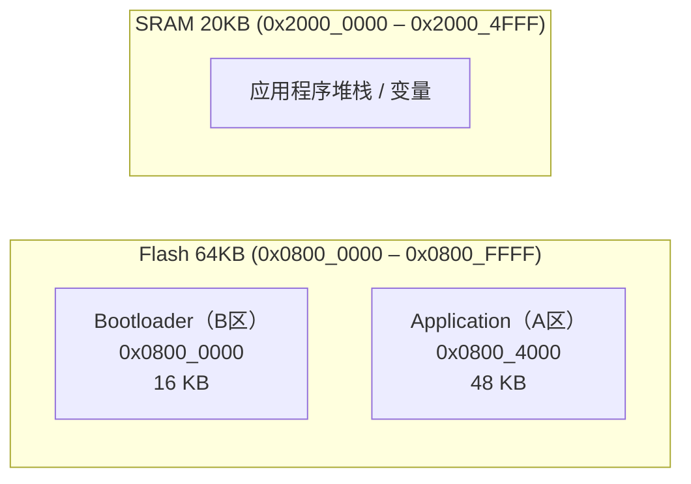
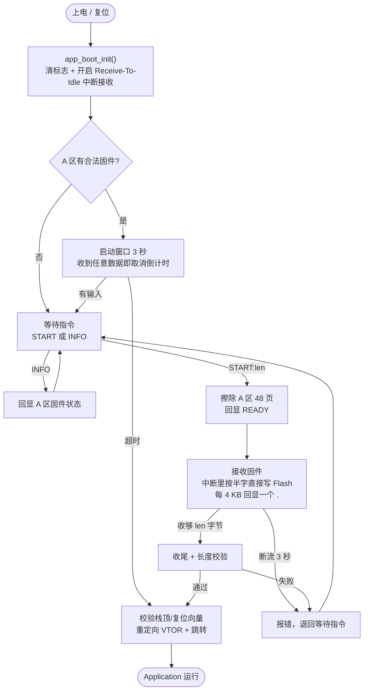

<div align="center">

# STM32 UART Bootloader（串口 IAP 固件升级）


**无需调试器，仅用一根串口线即可给 STM32 烧录 / 升级固件**

</div>

---

## 项目简介

这是一个运行在 **STM32F103C8T6** 上的 **UART 串口 Bootloader（IAP，In-Application Programming）**。
产品出厂后或现场维护时，**不拆壳、不接 SWD/JTAG 调试器**，只用 USART1 就能把新的应用程序固件写进 Flash 并跳转运行。

核心价值：

- **零额外硬件**：复用板载串口（PA9/PA10），不需要专用下载器。
- **适合量产与售后**：产线烧录、现场固件升级（OTA 的"有线版"）都能直接复用。
- **代码分层、可读性强**：底层能力与应用流程分开，方便移植到其它 MCU 或改成别的协议。

> ⚠️ **项目状态**：**WIP（开发中）**。串口指令协议、边收边写、长度与向量校验、自动跳转已跑通并实测；
> 整包 CRC、断点续传、A/B 双备份等仍在计划中，详见 [路线图](#路线图) 与 [已知问题](#已知问题--待完善)。

---

## 硬件平台

| 项目 | 说明 |
| --- | --- |
| MCU | STM32F103C8T6（Cortex-M3，72 MHz） |
| 封装 | LQFP48 |
| Flash | 64 KB（0x0800_0000 – 0x0800_FFFF） |
| RAM | 20 KB（0x2000_0000 – 0x2000_4FFF） |
| 串口 | USART1，**115200 / 8 / N / 1** |
| 引脚 | TX = PA9，RX = PA10 |
| 工具链 | STM32CubeMX 生成工程 + Keil MDK-ARM，HAL 库 |

---

## Flash 与内存布局

Bootloader 自身占用 Flash 前 16 KB，应用程序紧接其后，从 `0x0800_4000` 开始。
跳转时通过重定向中断向量表（`SCB->VTOR`）让应用程序接管中断。



| 区域 | 起始地址 | 大小 | 用途 |
| --- | --- | --- | --- |
| B区（Bootloader） | `0x0800_0000` | 16 KB | 引导程序自身 |
| A区（Application） | `0x0800_4000` | 48 KB | 用户应用程序（共 48 页，每页 1 KB） |
| SRAM | `0x2000_0000` | 20 KB | 运行时内存（栈指针合法性校验区间） |

---

## 工作原理

上电后 MCU 先运行 Bootloader。和"上电就擦掉旧固件"的做法不同，这里**只有在收到升级指令后才擦除 A 区**，
平时是直接跳转运行已有程序：



流程里有两个细节值得一提：

- **启动窗口（3 秒）**：A 区已有固件时，Bootloader 不会立刻跳走，而是留 3 秒给上位机。
  只要在这期间收到任何数据（哪怕只是一个字符），就认为"人在电脑前、想升级"，取消自动跳转。
  不做任何操作，3 秒后自动进入应用程序。
- **擦除时机后移**：只有在收到 `START:<len>`、确认用户要升级之后，才会擦除 A 区。
  这样即使升级中途断电，也不会因为"一上电就被擦"而丢掉旧固件。

---

## 串口指令协议

串口参数 **115200 / 8 / N / 1**，串口助手请勾选"发送新行（追加回车换行）"。

| 指令 | 作用 | 示例 |
| --- | --- | --- |
| `START:<len>` | 声明本次固件字节数，并开始升级 | `START:4164` |
| `INFO` | 查询 A 区固件状态（是否有效、占用大小等） | `INFO` |

解析时的容错策略（都是为了让手工敲命令不容易出错）：

- 关键字**不区分大小写**（`start` 也认）。
- `START` 和数字之间的分隔符 `:`、`,`、`=`、空格**都接受**（`START:4164`、`START 4164` 等价）。
- 数字之后不允许再有多余内容；`<len>` 必须是 1 ~ 49152（A 区容量）之间的十进制数。

一条典型的上电日志：

```text
[BOOT] STM32 UART Bootloader (A:0x08004000, 48KB)
[BOOT] APP found, wait 3000 ms (any input cancels the timer)
[BOOT] no input -> jump to APP
[BOOT] cmd: START:<len_dec>  |  INFO   (e.g. START:4164)
[BOOT] after READY, send the .bin (keep 256B / 500ms packet delay)
```

---

## 升级操作步骤

1. 用串口助手连接 USART1，参数 **115200 8N1**，勾选"发送新行"。
2. 给板子复位。若 A 区已有固件，会看到 3 秒倒计时；**在倒计时内随便发一个字符**即可取消自动跳转（已经跳进 App 了就得重新复位）。
3. 发送 `START:<len>`，其中 `<len>` 是待升级 `.bin` 文件的**十进制字节数**（例如文件 4164 字节就发 `START:4164`）。
4. 等 Bootloader 回显 `[OTA] READY - send the .bin now`。
5. 用串口助手的**"发送文件"**功能发送 `.bin`，并设置 **每包 256 字节、包间延时 500 ms**（这一步很关键，见下方说明）。
6. 传输完成后会看到 `[OTA] length check OK` 与 `[OTA] JUMP to 0x...`，随后 MCU 自动跳转运行新程序。

> 📌 **为什么一定要加包间隔？**
> Bootloader 是在**串口中断里直接写 Flash** 的，写 256 字节 ≈ 128 个半字 × 52.5 µs ≈ **6.7 ms**。
> 而 USART 只有 **2 字节**的硬件接收缓冲，如果上位机不带延时地连续灌数据，
> 中断还没把这一包写完、缓冲就已经被覆盖，**数据会丢**。
> 设置 500 ms 包间延时，相当于留了约 74 倍余量，非常安全。
> 想加快速度，可以把包调小（如 128 字节）并相应减小延时，但不要去掉延时。

---

## 分层架构

代码分成两层，各管一件事。"**什么时候干**"和"**怎么干**"分开，是这次重构的重点：

| 层 | 文件 | 职责 |
| --- | --- | --- |
| **应用层** | `MDK-ARM/app/app_boot.c` | 解析串口指令、编排升级流程（等待→擦除→接收→校验→跳转）、回显进度与错误、断流超时判定、启动窗口倒计时 |
| **接口层** | `MDK-ARM/interface/int_bootloader.c` | 提供底层原语：串口接收缓冲与中断搬运、A 区 Flash 擦除/半字写入、固件合法性校验、干净跳转 |

- `main.c` 中上电调用一次 `app_boot_init()`，之后主循环反复调用 `app_boot_poll()` 驱动状态机。
- 应用层不碰任何寄存器，所有 Flash 与串口操作都通过 `int_bootloader.h` 暴露的接口完成。
- 接口层不认识 `START` 指令、也不知道窗口期，只提供"能力"，不掺业务判断。

应用层的状态机只有四个状态：

```text
ST_WAIT  →  ST_ERASE  →  ST_RECV  →  ST_CHECK  →  (跳转 APP)
   ↑____________失败/超时/校验不过__________|
```

---

## 目录结构

```
uart_bootloader/
├── Core/                     # CubeMX 生成的应用框架（main.c / usart.c / gpio.c ...）
│   ├── Inc/                  # 头文件
│   └── Src/                  # 源文件
├── Drivers/                  # STM32 HAL 库 + CMSIS（CubeMX 引入，遵循其 LICENSE）
├── MDK-ARM/
│   ├── app/                  # ★ 应用层：指令解析 / 流程编排 / 回显
│   │   ├── app_boot.h
│   │   └── app_boot.c
│   ├── interface/            # 接口层：串口缓冲 / Flash 擦写 / 校验 / 跳转
│   │   ├── int_bootloader.h
│   │   └── int_bootloader.c
│   ├── uart_bootloader/      # Keil 编译输出（Objects 等中间文件，已被 .gitignore 忽略）
│   └── uart_bootloader.uvprojx   # Keil MDK-ARM 工程文件
└── uart_bootloader.ioc       # STM32CubeMX 工程配置
```

---

## 关键实现要点

1. **中断驱动接收（无阻塞）**：使用 `HAL_UARTEx_ReceiveToIdle_IT()`，
   靠"空闲线（Idle Line）"判定一帧结束，每收一帧自动重新武装接收，主循环不做阻塞轮询。
2. **半字写入 Flash**：STM32 Flash 最小编程单位是 16 位（halfword），
   接收缓冲按"两字节拼一个半字"调用 `HAL_FLASH_Program(FLASH_TYPEPROGRAM_HALFWORD, ...)`。
3. **跨帧奇数字节拼接**：当某一帧长度为奇数时，末字节先暂存（`half_carry`），
   等下一帧首字节到达后拼成完整半字。这样任意长度固件都能正确落盘；
   若总长为奇数，收尾时（`flash_flush_carry`）用 `0xFF` 补齐最后一个半字。
4. **边收边写**：`int_bootloader_flash_begin()` 擦除 A 区后进入"流式写入"模式，
   之后每一帧固件数据在中断里直接写进 Flash，不需要额外的整包 RAM 缓冲。
5. **长度与向量双重把关**：接收阶段检测"收到的数据多于声明长度"（`overflow_flag`）；
   跳转前再校验**复位向量**是否落在 A 区、**栈顶指针**是否落在 SRAM 且 4 字节对齐，
   任一不符就退回等待，绝不"跳飞"。
6. **干净的跳转交接**：关中断 → `HAL_DeInit()` → `__set_MSP()` 重设栈顶 →
   `SCB->VTOR = A区地址` 重定向向量表 → 调用 App 复位向量，完成"无痕迹"交接。
7. **固件大小推断**：不在 Flash 里存元数据，靠"从后往前找第一个非 `0xFF` 字节"估算占用大小。
   因为每次升级都会全擦 A 区，所以这个值是准的。

---

## 编译与烧录

1. 用 **STM32CubeMX** 打开 `uart_bootloader.ioc` 生成/同步工程（已配置 USART1、HSE 8M → PLL 72M）。
2. 用 **Keil MDK-ARM** 打开 `MDK-ARM/uart_bootloader.uvprojx`，编译得到 `uart_bootloader.hex`。
3. 首次用 ST-Link / DAP-Link 等把 Bootloader 烧录进 `0x0800_0000`（16 KB 内）。
4. 之后应用程序的 `.hex` / `.bin` 烧录起始地址设为 `0x0800_4000`；
   现场升级则按 [升级操作步骤](#升级操作步骤) 用串口发送 `.bin` 即可。

---

## 技术亮点

> 这部分是项目的"能力提炼"，也方便招聘方快速评估匹配度。

- **裸机 Flash 编程**：熟悉 STM32 闪存解锁 / 页擦除 / `HAL_FLASH_Program` 半字编程的完整时序与约束。
- **中断驱动串口（无阻塞）**：`Receive-To-Idle` + 空闲中断，配合中断内流式写 Flash。
- **健壮的字节流处理**：解决"跨帧奇数字节"拼接，保证任意长度固件都能正确写入。
- **轻量指令协议**：`START:<len>` / `INFO`，带大小写与分隔符容错，靠声明长度做完整性判断。
- **安全的程序跳转**：复位向量 + 栈指针双重校验、`VTOR` 重定向、`MSP` 重设，规避"跳飞"死机。
- **清晰的分层设计**：接口层（怎么干）与应用层（什么时候干）解耦，便于替换协议或移植平台。
- **IAP 分区思维**：Bootloader / Application 双区划分与地址规划，是 OTA / 固件升级的通用范式。

---

## 路线图

- [x] 升级握手协议：收到 `START:<len>` 才进入升级，否则自动跳转已有 App
- [x] 上电启动窗口：3 秒内可取消自动跳转，方便现场插上升级
- [ ] Flash 写入后**回读校验** / 整包 **CRC32** 校验（目前只做长度与向量校验）
- [ ] 支持 **YMODEM / XMODEM** 等标准传输协议，对接通用串口工具
- [ ] A/B 双备份分区 + 升级失败**自动回滚**（当前升级失败会停在 Bootloader，需重发）
- [ ] 看门狗 / 更细的超时保护，防止升级中途异常变砖

---

## 已知问题 / 待完善

- **依赖上位机包间隔**：如上文所述，连续无延时发送会丢数据。若上位机不支持设包延时，需先改进为环形缓冲或 DMA。
- **断流超时固定 3 秒**：慢速上位机或大数据量时可能误判超时，建议做成可配置。
- **无内容校验**：只有长度校验和向量校验，没有 CRC / 哈希，理论上无法发现"长度对但内容错"的情况。
- **无看门狗保护**：升级中途断电/复位只能重发，A 区处于残缺状态（下次上电会被判为非法而不跳转，不会变砖，但需重新升级）。
- **A 区大小靠扫描推断**：`INFO` 报出的固件大小由扫描非 `0xFF` 字节得到，属于估算而非精确记录。

---

## English Abstract

A minimal, interrupt-driven **UART bootloader (IAP)** for the **STM32F103C8T6**.
It receives firmware over USART1 (115200 8N1) using `HAL_UARTEx_ReceiveToIdle_IT()` and
programs the on-chip Flash in 16-bit halfwords while receiving, handling odd-byte
carry-over across packets. A tiny command protocol (`START:<len>` / `INFO`) lets the host
declare the firmware size and query the app region before flashing. Before jumping, the
bootloader validates the application's reset vector and stack pointer, then hands over with
`SCB->VTOR` remapped and `MSP` reloaded. On startup, if a valid app exists, a 3-second window
lets the host cancel the auto-jump. No debugger is required for field firmware updates.
Status: **WIP** — flashing path, command protocol and auto-jump are verified; CRC and
rollback are pending.

---

## 许可证

HAL 库与 CMSIS 相关代码遵循 `Drivers/` 目录内各自的 `LICENSE.txt`。
本项目其余源码的许可证**待定（TBD）**，如需用于商业/开源场景请与我联系。
